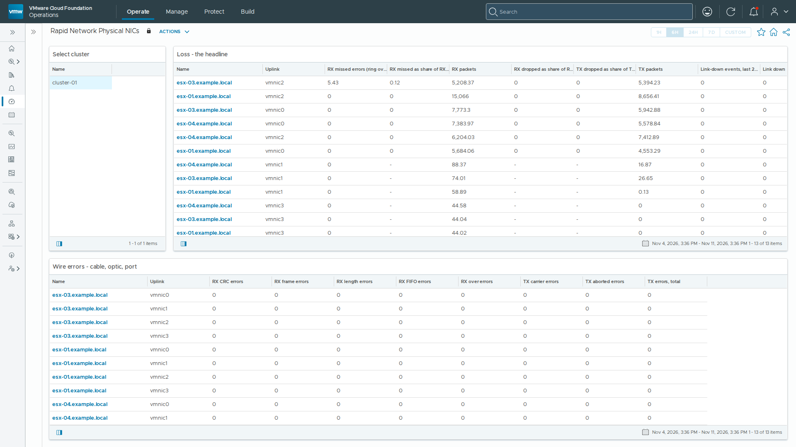

# Rapid Network Physical NICs

Text panels of the **Rapid Network Physical NICs** dashboard, as shipped in build 3.0.1.7 of vSphere Network Statistics. The dashboard sits in the *vSphere Network Statistics* dashboard folder.

The first screen of the dashboard; select it for the whole dashboard (`dashboard.png`).
The screenshot is from a lab; host, VM, cluster, portgroup and switch names and addresses have been replaced with neutral ones.

## How to read this

### Rapid Network pNIC — is any uplink losing frames right now?

Every physical uplink under the selected cluster, one row each, worst at the top. **Non-zero is the catch.** This is a triage screen, not a root-cause tool: it answers *whether* and *where*, not why.

**RX missed errors is the headline, and it is the reason this screen exists.** A missed error means the NIC ring had no free descriptor and the frame was dropped before the driver ever saw it. It is distinct from *RX dropped* (discarded higher up) and *RX errors* (arrived damaged) — and it is **not counted by the built-in `errorsRx` metric**, which is a truthful zero throughout. There is no representation of this counter anywhere in vCenter's 836 performance counters at any statistics level, so the estate's default network monitoring cannot see this failure at all. Everything else on this screen is context for it.

**Throughput is deliberately not on this screen.** A NIC dropping 0.1% of frames still moves traffic at line rate, so a throughput panel stays green through the exact fault this exists to find.

**Every rate column shows the period maximum, not the current value.** Ring overruns arrive in bursts — a thousand or more in one five-minute interval, then nothing for an hour. A current value misses most such bursts; the maximum over the dashboard period catches it, and the lifetime column beside it answers "has this NIC ever been bad".

**Bands.** Yellow starts at zero on every error column — any non-zero value is the finding. Orange and red are set an order of magnitude apart above it, and are this pack's own, chosen so that a materially worse fault escalates beyond yellow.

**Where vendor authority does exist,** it is used: the drop percentages use Broadcom's published 0.1% warning and 1.0% critical. The same 0.1% figure appears again as 1‰ in Broadcom's own default alarm *"High pNic error rate detected"*, which goes yellow on a host when the RX missed error rate reaches it — so the bands here are deliberately more sensitive than that alarm, not unanchored from it.

**That alarm overlaps this screen, on vSAN uplinks only.** It is an OR of eight vSAN health counters — CRC, generic RX, FIFO, missed, buffer overflow, TX carrier, TX generic and pause — and it fires only for uplinks carrying vSAN traffic. On every other uplink it is silent, which is the gap this screen exists to fill.

**Link-down events** are counted from vCenter's event stream, because no counter anywhere records a link transition. A NIC flapping on its own is a cable, optic or switch port on its way out; every NIC on a host flapping at once is a reboot, and is suppressed.

**The vCenter panel is the contrast.** It shows what the built-in adapter sees for the same hosts. When it reads zero beside a climbing missed-error column, that gap is why this screen exists.

**"Ring config not reported" is a finding, not an error.** It is amber because some drivers refuse to report ring size at all — `nmlx5_core` is one. Those uplinks are shown as unreported rather than as zero, because a zero there would be the same false green this screen is built to replace.

### What this screen does not collect

**Green means no error counter is advancing. It is not a health guarantee.** These are the gaps, named here on purpose:

**Pause-frame counts, and the direction that would make them useful.** Only pause *configuration* is reachable without a host shell — the two pause columns on this screen say whether pause is *enabled*, and are not counts of anything. The counts live behind `localcli --plugin-dir /usr/lib/vmware/esxcli/int networkinternal nic privstats get`, the command Broadcom's own `nicinfo.sh` uses. That plugin directory is not registered with hostd and `localcli` bypasses hostd by construction, so neither `esxcli` through vCenter nor PowerCLI's `Get-EsxCli` can reach it.

The loss is specifically **direction**, and direction is the whole diagnosis. Pause *sent* means this host's receive path cannot keep up, and the fix is ring buffers and coalescing — ours. Pause *received* means the fabric upstream is congested, and the fix belongs to the network team. Those are opposite conclusions from the same missing field, so an rx-missed burst on this screen cannot be attributed without a host shell.

**Per-queue counters** — `csumErr`, `txBusy`, `queueFull`, and vendor firmware discard reasons. Same reason: host shell only.

**Ring configuration, and exactly what to ask your NIC vendor for.** Ring size is not something ESXi measures — it is something the *driver* publishes. `esxcli network nic ring current get` and `ring preset get` both read one VMkernel Sysinfo node:

`VSI_NODE_net_pNics_firmware_ringParams`

A driver that populates that node reports its ring sizes; a driver that does not makes the node *non-existent*, and both calls fail with `CLIFault — Not supported`. That is the whole mechanism. It is a **driver** property, not a hardware limitation and not a licensing tier — the silicon knows its own ring sizes, the driver simply never hands them up.

**So the request to make of a vendor is specific and citable:** ask them to populate `VSI_NODE_net_pNics_firmware_ringParams` in their ESXi driver, so that `esxcli network nic ring current get` and `ring preset get` return values instead of `Not supported`. That one sentence is the entire feature gap. It is not a request for new telemetry, new counters or a new API — the interface already exists and other vendors already answer on it.

**Quote the driver and its version, not the card.** Both are on the Ring and posture panel, in their own columns. A vendor's first question is which driver build, and the answer is a property of the driver rather than of the adapter — the same card with a different driver may well answer. An `nmlx5_core` row that refuses beside an `ixgben` row that answers is the whole case in two rows.

**The comparison is the argument.** On identical hosts and the same ESXi build, `ixgben` (Intel) answers on *both* its ENS-capable and non-ENS uplinks — current RX/TX 4096, maximum 8192. `nmlx5_core` (Mellanox ConnectX-4 Lx) refuses on both. The driver is the discriminator, **not ENS**, and not the adapter. Because the node does not exist, `vsish` cannot reach it either, and Broadcom's own `nicinfo.sh` makes the same two calls this screen does and gets the same refusal — so there is no workaround at any level, including the one support will run. A non-default ring size set on such an uplink is one no call will confirm.

**TCP-stack error rates.** No vCenter surface. The built-in adapter defines TCP error counters on the host and they read zero constantly.

**Ring *utilisation*.** Ring size is configuration; occupancy is a producer/consumer index pair moving at line rate and no counter maintains it. Drivers publish the consequence instead, which is the missed-error counter at the top of this screen.

**Vendor coverage.** Driver behaviour has been verified on Intel (`ixgben`) and NVIDIA/Mellanox (`nmlx5_core`) only. Broadcom, Marvell/QLogic and Pensando are unverified: the collector enumerates capability per NIC rather than assuming it, but that is two columns of evidence, not five.

### Every metric on this screen

Build 3.0.1.7 · release

Generated from the adapter's own model at build time, so it matches exactly what this version collects. **A blank cell is not a zero** — where a driver refuses a read or a rate has no previous sample, this pack emits nothing rather than a zero, because a zero would mean "measured, and fine".

**Physical uplink (pNIC)** — 45 metrics, 17 properties

| Metric | Key | Unit | Source | Band | Notes |
|---|---|---|---|---|---|
| **RX missed errors (ring overrun)** · KPI | `rxMissedRate` | errors/s | network.nic.stats.get | yellow > 0, orange 0.1, red 1 | Ring had no free descriptor; frame dropped before the driver saw it. errorsRx excludes this. |
| **RX missed errors, lifetime** | `rxMissedTotal` | errors | network.nic.stats.get | context only, never coloured | Cumulative. Resets on driver reload -- never threshold this. |
| **RX missed as share of RX packets** · KPI | `rxMissedPct` | % | derived on the adapter | yellow > 0, orange 0.001, red 0.01 | — |
| **RX CRC errors** · KPI | `rxCrcRate` | errors/s | network.nic.stats.get | yellow > 0, orange 0.1, red 1 | — |
| **RX frame errors** | `rxFrameRate` | errors/s | network.nic.stats.get | yellow > 0, orange 0.1, red 1 | — |
| **RX length errors** | `rxLengthRate` | errors/s | network.nic.stats.get | yellow > 0, orange 0.1, red 1 | The canonical home for frames outside the valid size range -- oversize (jabber, over-MTU) AND undersize (runt). Intel counts these in RLEC/ROC/RUC. If you are hunting an MTU mismatch on the wire, this is the field, not rxOverRate. UNVERIFIED against a real oversize frame. |
| **RX FIFO errors** | `rxFifoRate` | errors/s | network.nic.stats.get | yellow > 0, orange 0.1, red 1 | — |
| **RX over errors** | `rxOverRate` | errors/s | network.nic.stats.get | yellow > 0, orange 0.1, red 1 | AMBIGUOUS, deliberately left unexplained on the screen. The canonical net_device_stats definition is 'receiver ring buffer overflow', which is why it sits under buffer pressure here -- but the name invites an 'oversized frame' reading and driver practice is genuinely inconsistent. Oversize belongs in rxLengthRate. ixgben, nmlx5_core and cdce leave this 0 even on an uplink with thousands of missed errors. Treat a non-zero value as 'the driver is reporting a receive-side overflow of SOME kind' and corroborate with rxMissedRate and rxLengthRate before naming a cause. |
| **TX carrier errors** | `txCarrierRate` | errors/s | network.nic.stats.get | yellow > 0, orange 0.1, red 1 | — |
| **TX aborted errors** | `txAbortedRate` | errors/s | network.nic.stats.get | yellow > 0, orange 0.1, red 1 | — |
| **TX FIFO errors** | `txFifoRate` | errors/s | network.nic.stats.get | context only, never coloured | — |
| **TX heartbeat errors** | `txHeartbeatRate` | errors/s | network.nic.stats.get | context only, never coloured | — |
| **TX window errors** | `txWindowRate` | errors/s | network.nic.stats.get | context only, never coloured | — |
| **RX packets dropped** · KPI | `rxDroppedRate` | packets/s | network.nic.stats.get | yellow > 0, orange 1, red 10 | — |
| **TX packets dropped** · KPI | `txDroppedRate` | packets/s | network.nic.stats.get | yellow > 0, orange 1, red 10 | — |
| **RX dropped as share of RX packets** | `rxDroppedPct` | % | derived on the adapter | yellow > 0, orange 0.1, red 1 | 0.1% warn is Broadcom's published band. |
| **TX dropped as share of TX packets** | `txDroppedPct` | % | derived on the adapter | yellow > 0, orange 0.1, red 1 | — |
| **RX errors, total (the counter that reads 0)** | `rxErrorsRate` | errors/s | network.nic.stats.get | context only, never coloured | Same semantics as vCenter errorsRx. Kept unbounded on purpose: it is evidence, not an alarm. |
| **TX errors, total** | `txErrorsRate` | errors/s | network.nic.stats.get | context only, never coloured | — |
| **RX ring size, current** | `ringRxCurrent` | — | network.nic.ring.current.get / ring.preset.get | context only, never coloured | Descriptors. |
| **RX ring size, maximum** | `ringRxMax` | — | network.nic.ring.current.get / ring.preset.get | context only, never coloured | — |
| **TX ring size, current** | `ringTxCurrent` | — | network.nic.ring.current.get / ring.preset.get | context only, never coloured | — |
| **TX ring size, maximum** | `ringTxMax` | — | network.nic.ring.current.get / ring.preset.get | context only, never coloured | — |
| **RX ring size as share of maximum** | `ringRxPctOfMax` | % | derived on the adapter | context only, never coloured | Headroom, not utilisation. e.g. an uplink at 50% (4096 of 8192) has room to grow its ring if it is dropping. |
| **Ring config not reported by driver** | `ringConfigUnavailable` | — | network.nic.ring.current.get / ring.preset.get | yellow > 0, orange 0.5, red 2 | 1 = the driver refused. nmlx5_core does this (VSI_NODE_net_pNics_firmware_ringParams). Amber, not red: absence is a finding, not a fault. NEVER report 0 ring size here. |
| **Link down** · KPI | `linkDown` | — | network.nic.list | 0/1 state — 1 is red | Inverted from linkUp so ascending bounds colour correctly. |
| **Virtual uplink (nested ESXi)** | `virtualUplink` | — | network.nic.list | yellow > 0, orange 0.5, red 2 | 1 = this host's uplink is a vNIC, so the host is nested. Amber, not red: nothing is wrong, but the physical-layer error columns above are not meaningful on it -- there is no cable, optic or FIFO behind a virtual device. nic.stats.get returns the same 24 fields whatever the driver, so a nested uplink reads 0 for CRC/frame/length/missed and no API call distinguishes 'measured zero' from 'not implemented'. That is a false green of exactly the kind this pack exists to kill, so it is flagged from the driver name instead. UNVERIFIED against a nested host. |
| **Link speed** | `speedMbps` | Mbit/s | network.nic.list | context only, never coloured | — |
| **MTU** | `mtu` | B | network.nic.list | context only, never coloured | — |
| **Link-down events, last 24h** | `linkFlaps24h` | — | vCenter EventManager (esx.problem.net.vmnic.linkstate.down) | yellow > 0, orange 1, red 3 | No counter anywhere carries this; it only exists as events. Most link-down events are host-wide (all vmnics within seconds = reboot/maintenance); a single-NIC flap is the shape that matters. The adapter should suppress host-wide bursts. |
| **RX netqueues** | `netqueueRxCount` | — | network.nic.queue.count.get | context only, never coloured | Driver-dependent: ixgben answers (8), ENS-mode nmlx5_core refuses. Absence recorded, never 0. |
| **RX packets** | `rxPktRate` | packets/s | network.nic.stats.get | context only, never coloured | — |
| **TX packets** | `txPktRate` | packets/s | network.nic.stats.get | context only, never coloured | — |
| **RX throughput** | `rxBps` | B/s | network.nic.stats.get | context only, never coloured | — |
| **TX throughput** | `txBps` | B/s | network.nic.stats.get | context only, never coloured | — |
| **RX throughput** | `rxMbitps` | Mbit/s | derived on the adapter | context only, never coloured | Network throughput in BITS, which is how a network is specified, sold and troubleshot -- a 25 Gbps NIC is 25 gigaBITS. The `rxBps` metric carries the same counter in bytes/s for anyone who wants it; this is the one the dashboards show. |
| **TX throughput** | `txMbitps` | Mbit/s | derived on the adapter | context only, never coloured | Network throughput in BITS, which is how a network is specified, sold and troubleshot -- a 25 Gbps NIC is 25 gigaBITS. The `txBps` metric carries the same counter in bytes/s for anyone who wants it; this is the one the dashboards show. |
| **RX broadcast** | `rxBcastRate` | packets/s | network.nic.stats.get | context only, never coloured | — |
| **RX multicast** | `rxMcastRate` | packets/s | network.nic.stats.get | context only, never coloured | — |
| **TX broadcast** | `txBcastRate` | packets/s | network.nic.stats.get | context only, never coloured | — |
| **TX multicast** | `txMcastRate` | packets/s | network.nic.stats.get | context only, never coloured | — |
| **RX broadcast as share of RX packets** | `bcastRxPct` | % | derived on the adapter | yellow > 0, orange 20, red 50 | Band is ours, not borrowed authority. Emits NOTHING below 100 packets/s: an idle uplink sees only ARP and discovery traffic, so the share approaches 100% by arithmetic -- e.g. 99.99% on a link carrying 3.6 pps. |
| **RX multicast as share of RX packets** | `mcastRxPct` | % | derived on the adapter | yellow > 0, orange 20, red 50 | Band is ours. A DVS on multicastFilteringMode=basic floods all multicast to every port. |
| **Team speed mismatch** | `teamSpeedMismatch` | — | derived on the adapter | 0/1 state — 1 is red | Scoped PER SWITCH, not per host. Per host it would fire wherever, say, Mellanox and Intel uplinks sit on different switches by design. Emits nothing where the switch cannot be resolved. |
| **Team load skew** | `teamLoadSkew` | — | derived on the adapter | yellow > 0, orange 1.8, red 3 | 1.0 is perfect balance; worst case equals the member count. One uplink carrying most of a team's traffic is what turns a routine burst into a ring-overrun spike on that uplink. Emits NOTHING below 500 pps total or with one member: at 3 pps across 8 queues everything looks maximally skewed, and a single-member team is always 1.0 = 100% of worst case. |

| Property | Key | Source | Notes |
|---|---|---|---|
| **Driver** | `driver` | network.nic.get | ixgben, nmlx5_core, ... |
| **Driver version** | `driverVersion` | network.nic.list | The ESXi driver's own version, distinct from the adapter firmware beside it. Quote it with the driver name when asking a vendor about a capability this screen reports as unavailable. |
| **Firmware version** | `firmwareVersion` | network.nic.get | — |
| **Adapter** | `description` | network.nic.list | — |
| **Duplex** | `duplex` | network.nic.list | — |
| **Pause RX (configured)** | `pauseRx` | network.nic.pauseParams.list | Configuration only -- pause frame *counts* are host-shell only. NOT a count of received pause frames. |
| **Pause TX (configured)** | `pauseTx` | network.nic.pauseParams.list | Configuration only, same as pauseRx. NOT a count of sent pause frames. Direction is the diagnosis and we cannot get it -- see the pNIC blind-spots panel. |
| **Ring RX / max** | `ringStatus` | derived on the adapter | Either "4096 / 8192" or "not reported by <driver>". This is where the honesty rule lands on screen. |
| **Interrupt coalescing** | `coalescePosture` | network.nic.coalesce.get | "adaptive RX, 3 us / 64 frames" -- or "N/A" where the driver reports nothing (ixgben does). Posture, not a counter; shown so a ring overrun can be read against it. |
| **Cable** | `cableType` | network.nic.get | DA / Fibre / Twisted pair. |
| **Physical-layer error counters** | `physicalLayerCounters` | derived on the adapter | "implemented" on a real NIC; "not applicable - virtual uplink (vmxnet3)" on a nested host. The text a nested estate's operator needs beside a column of zeroes. |
| **Switch** | `switch` | VirtualMachine.config (hardware.device / extraConfig) | The host proxy switch this uplink is attached to, or absent when it is attached to none. |
| **Link speed** | `linkSpeed` | network.nic.list | Negotiated link speed, written the way an operator says it out loud: "25 Gbps". The `speedMbps` metric carries the same figure in Mbit/s for alerting and trending. |
| **Link speed capable** | `linkSpeedCapable` | network.nic.list | The highest speed this adapter ADVERTISES, from <code>AdvertisedLinkModes</code> -- e.g. 25 Gbps for a ConnectX-4 Lx, 10 Gbps for an X550. Read it against "Link speed" beside it: when the negotiated speed is lower, this column says <b>LINKED BELOW CAPABILITY</b>. That is a cable, optic or switch-port fault nothing else on this screen reveals -- the link is up, and throughput looks healthy for the speed it settled on. |
| **Auto-negotiation** | `autoNegotiation` | network.nic.list | Whether the port auto-negotiated or was forced. A forced port that negotiated below its capability was configured that way; an auto port that did is a fault. |
| **Team speeds** | `teamSpeeds` | derived on the adapter | Every distinct link speed among this switch's up, non-virtual uplinks on this host, and whether they agree -- "25 Gbps" or "10 + 25 Gbps (MISMATCH)". The `teamSpeedMismatch` metric is the same fact as 0 or 1, for alerting; this says WHICH speeds, which is the part needed to act on it. |
| **Datapath mode** | `datapathMode` | VirtualMachine.config (hardware.device / extraConfig) | From vCenter's proxy-switch `ensEnabled`, which is a reported property rather than an interpretation. It replaced an inference from queue.count.get refusing with 'Netqueue config not supported on ENS driver'; the two agree, but the property also distinguishes 'not ENS' from 'attached to no switch'. |

**VMkernel interface** — 15 metrics, 7 properties

| Metric | Key | Unit | Source | Band | Notes |
|---|---|---|---|---|---|
| **RX packets dropped** · KPI | `rxDroppedRate` | packets/s | network.port.stats.get | yellow > 0, orange 0.1, red 1 | Per-netstack loss. |
| **TX packets dropped** · KPI | `txDroppedRate` | packets/s | network.port.stats.get | yellow > 0, orange 0.1, red 1 | — |
| **Packets dropped in port filters** | `filterDroppedRate` | packets/s | network.port.filter.stats.get | yellow > 0, orange 0.1, red 1 | A drop location invisible to nic.stats and port.stats both. |
| **Packet errors in port filters** | `filterErrorsRate` | errors/s | network.port.filter.stats.get | yellow > 0, orange 0.1, red 1 | — |
| **Packets queued in port filters** | `filterQueued` | — | network.port.filter.stats.get | context only, never coloured | Gauge. Non-zero under load is backpressure in the filter chain. |
| **MTU** | `mtu` | B | network.ip.interface.list | context only, never coloured | — |
| **MTU exceeds its switch's lowest uplink** | `mtuMismatch` | — | derived on the adapter | 0/1 state — 1 is red | The failure mode is a vmk sending frames its uplink cannot carry (vmk 9000 on a 1500 uplink) -- those drop silently under load. A 1500 vmk on a 9000 uplink is normal and must NOT fire. Compared against EVERY up, non-virtual, non-USB uplink on this interface's own switch, not against one active uplink -- the active uplink for a vmk is a runtime teaming decision that nothing agentless reports. That is the stronger check: a 9000 vmk on a switch where ANY member is 1500 is exposed the moment teaming moves it. Emits nothing where the switch or its uplink set cannot be read -- an unknown team is not evidence of a healthy MTU. |
| **RX dropped, lifetime** | `rxDroppedTotal` | packets | network.nic.stats.get | context only, never coloured | Cumulative since the port was created, not a rate. |
| **TX dropped, lifetime** | `txDroppedTotal` | packets | network.nic.stats.get | context only, never coloured | Cumulative since the port was created, not a rate. |
| **RX packets** | `rxPktRate` | packets/s | network.port.stats.get | context only, never coloured | — |
| **TX packets** | `txPktRate` | packets/s | network.port.stats.get | context only, never coloured | — |
| **RX throughput** | `rxBps` | B/s | network.port.stats.get | context only, never coloured | — |
| **TX throughput** | `txBps` | B/s | network.port.stats.get | context only, never coloured | — |
| **RX throughput** | `rxMbitps` | Mbit/s | derived on the adapter | context only, never coloured | Bits, not bytes -- a network is specified and sold in bits. `rxBps` carries the same counter in bytes/s. |
| **TX throughput** | `txMbitps` | Mbit/s | derived on the adapter | context only, never coloured | Bits, not bytes -- a network is specified and sold in bits. `txBps` carries the same counter in bytes/s. |

| Property | Key | Source | Notes |
|---|---|---|---|
| **Role** | `role` | derived on the adapter | TEP / vMotion / Management / Hyperbus / Storage, derived from the netstack. TEP == the `vxlan` netstack, which is the NSX tunnel endpoint -- a reliable discriminator. This is the column the TEP view is read on: Operations views select by resource KIND, not by property value, so the view ships the whole kind with role leading and the operator sorts on it. |
| **Netstack** | `netstack` | network.ip.interface.list | defaultTcpipStack / vmotion / vxlan / hyperbus. The grouping dimension -- carry it in the object name too, see tools/build_dashboard.py. |
| **Switch port ID** | `portId` | network.ip.interface.list | — |
| **Switch** | `switch` | network.ip.interface.list | The vSwitch or DVS this interface egresses through, from `network ip interface list` (VDSName / Portset). Replaces an "Egress uplink" column that was blank on every row: the ACTIVE uplink for a VMkernel port is a runtime teaming decision, and nothing agentless reports it -- esxcli exposes TeamUplink only on the VM-port surface, and a DVPort's runtimeInfo names linkPeer and the MAC but not the uplink. The switch is the honest unit: it is what the MTU check compares against. |
| **ECN** | `ecnStatus` | network.ip.netstack.get | Per netstack. |
| **Port filter statistics** | `filterStatsAvailable` | derived on the adapter | Whether the IOChain filter on this port reports counters. The filter differs by port type: VMkernel ports carry <code>ESXi-Firewall</code>, the host firewall; VM ports carry <code>vmware-vds-vsip</code>, the NSX distributed firewall dataplane. Neither is NIOC -- network shares, limits and reservations are a DVS scheduler rather than an IOChain filter, so they never appear here. |
| **TCP congestion control** | `congestionControl` | network.ip.netstack.get | Per netstack. A stack set to cubic on one host and newreno on another is a finding. |

## Complete the install

### Complete the install

Installing the pak adds these dashboards, but **it cannot create its own vCenter connection**. Until the steps below are done, every panel above stays empty.

**1. Add the vCenter account8.18:** Administration → Integrations → Accounts → **ADD** → **vSphere Network Statistics9.1.1:Operate** tab → Administration → Integrations → Accounts → **ADD** → **vSphere Network Statistics**

Fill in **Name**; **vCenter Server (FQDN)**, the name on vCenter's certificate; **Port** 443; **Credential**, a *read-only* vCenter user and password; and the proxy that reaches vCenter, under **Collector / Group** on 8.18 or **Cloud Proxy / Group** on 9.1.1. Leave **Advanced Settings** as they are. Then **VALIDATE CONNECTION**, accept vCenter's certificate when asked, and **ADD**.

**2. Make sure it is collecting**

Administration → Integrations → Accounts, expand **vSphere Network Statistics** with its arrow. The account's **Status** should read `OK` on 8.18 or `Collecting` on 9.1.1. If it does not, open the account's **⋮** menu and choose **Start Collecting**. Accepting the certificate can leave the account stopped, and so can a pak upgrade, so check again after either.

**3. Coming from 2.x**

If the 2.x pack is still installed, delete its account and uninstall it (Integrations → Repository). 2.x and 3.x write the same keys, so only one may run against a vCenter. History carries over: the keys are unchanged.

**4. Then wait**

Values arrive within one collection cycle (about 5 minutes). Rate and percentage columns fill from the second cycle. Right after an install or upgrade every widget can show *The widget is not configured* with an hourglass for up to 15 minutes while Operations binds it to its view; nothing needs doing.
