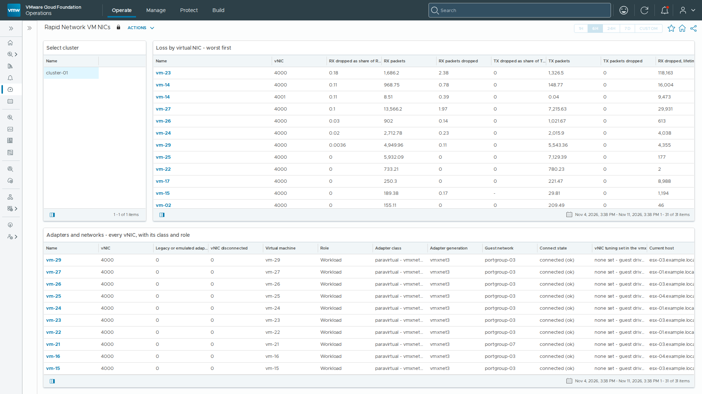

# Rapid Network VM NICs

Text panels of the **Rapid Network VM NICs** dashboard, as shipped in build 3.0.1.7 of vSphere Network Statistics. The dashboard sits in the *vSphere Network Statistics* dashboard folder.

The first screen of the dashboard; select it for the whole dashboard (`dashboard.png`).
The screenshot is from a lab; host, VM, cluster, portgroup and switch names and addresses have been replaced with neutral ones.

## How to read this

### Rapid Network VM — is a guest losing frames?

One row per virtual NIC, worst at the top, with the VM name and the uplink its traffic leaves through on the same row. **Non-zero is the catch.What a dropped frame here means.** The virtual switch had a frame for this guest and could not hand it over. On a vmxnet3 adapter the usual cause is inside the guest: its receive ring had no free buffer, because the guest is not draining the ring fast enough — a busy or starved VM, an old or misbehaving driver, or a ring left at its default size under a load that outgrew it.

**So the drop columns are how a buffer overrun is detected** — one layer out from the ring itself. A sustained non-zero rate on a busy guest is the overrun. What cannot be obtained is the *depth* that caused it: the vmxnet3 out-of-buffer counters and ring sizes exist only in `vsish` on the host, and `vsish` has no API at all — it is absent from every one of the 444 command handlers vCenter exposes. Nor is there an event: of the 2,347 event types vCenter defines, exactly one mentions a buffer overflow and it is for a *physical* adapter. Read these columns as "the port could not deliver", of which an overrun is the common case; a blocked port or a filter can also do it.

**When you have a host shell, this is how you get the depth.** Read-only, nothing resets a counter. Find the port first — the World ID changes on every power cycle, and a VM with several vNICs has several similar-looking port IDs, so confirm the MAC before trusting the rest:

`esxcli network vm list`
 `esxcli network vm port list -w <WORLD_ID>`

Then separate the port from the filter in front of it, because they fail differently and are owned by different people. On a VM port the filter is `vmware-vds-vsip` — the NSX distributed firewall — so a drop there is the firewall dropping, not the vNIC:

`esxcli network port stats get -p <PORT_ID>`
 `esxcli network port filter stats get -p <PORT_ID>`

Only then the ring itself, which is the part nothing above this line can reach. Discover the path with `ls` rather than typing a remembered one — portset naming differs between a standard switch and a VDS:

`vsish -e ls /net/portsets/`
 `vsish -e get /net/portsets/<PORTSET>/ports/<PORT_ID>/vmxnet3/rxSummary`

**"running out of buffers" is the finding** — non-zero means the guest did not drain the ring in time, or the ring is too small for the load. `net-stats -A -t vW -i 10` gives the same pressure as a rate rather than a lifetime total.

**And do not read a percentage off a quiet interface.** At ten packets a second a five-minute window holds about three thousand packets, so a handful of drops renders as a headline percentage. Work from the absolute counters when the rate is low; the loss percentages on these screens are suppressed below 100 pps for exactly this reason.

**Broadcast and multicast are split out on purpose.** A guest drowning in broadcast is a different fault from a guest dropping unicast traffic, and the two look identical in a total packet count.

**Follow the uplink column.** If several VMs on the same uplink are dropping at once, the fault is more likely to be that uplink or the fabric behind it than any of the guests — cross-check it on the pNIC screen.

**Distributed-firewall drops are not here.** Per-port filter statistics return real counters for VMkernel ports but can return an empty row for VM ports, so a frame dropped by the distributed firewall may be counted nowhere this pack can read. The column says so rather than showing a zero.

**Adapter class — three buckets, not two.** The inventory panel sorts every vNIC into one of three, because "not vmxnet3" and "anomaly" are different sets:

• **paravirtual — vmxnet3 family.** `VirtualVmxnet3` and `VirtualVmxnet3Vrdma` (vmxnet3 plus PVRDMA). Normal. No flag.
 • **passthrough — deliberate.** `VirtualSriovEthernetCard`. Not vmxnet3, and *not* an anomaly — SR-IOV is a deliberate choice for latency-sensitive and NFV-style workloads. Flagging it would be a false positive on exactly the people who chose it on purpose. No flag.
 • **emulated — ANOMALY.** `e1000`, `e1000e`, `pcnet32`, and the superseded paravirtual `vmxnet` and `vmxnet2`. Amber.
 • **unrecognised — review.** An adapter type this build has never seen. Also amber, deliberately: the alternative is that some future emulated device reads green forever.

**Why an emulated adapter is anomalous.** Spelled out here rather than linked, because vendor knowledge-base articles are moving behind a paywall and a dead link is worse than no link.

**1. It is software pretending to be silicon.** `e1000` and `e1000e` emulate real Intel chips. The guest driver writes to what it believes are hardware registers, and each access traps into the hypervisor to be interpreted. vmxnet3 is *paravirtual*: the guest driver knows it is virtual, shares a descriptor ring with the hypervisor directly, and signals in batches. There is no per-packet device emulation at all.

**2. One queue, therefore one vCPU.** This is usually the one that actually hurts. Emulated adapters are effectively single-queue, so all receive processing for the VM lands on one vCPU no matter how many it has. vmxnet3 supports RSS across multiple receive queues, spreading that work. A 16-vCPU database on `e1000e` can be throttled by one saturated core while the other fifteen idle, and nothing in the guest's own CPU average will look alarming.

**3. A 1 Gbit link speed, reported to the guest.** Emulated adapters advertise 1 Gbit. Beyond the throughput ceiling, software inside the guest reads that number and acts on it — load balancers, clustering software and some JVM and database heuristics size themselves from reported link speed. vmxnet3 reports 10 Gbit or better.

**4. Fewer offloads, more host CPU per bit.** vmxnet3 carries TSO, LRO, checksum offload and a receive data ring for small packets. Emulated paths support less and emulate more, so the same traffic costs measurably more host CPU — a cost paid on every host, by every other VM.

**5. No promotion path.** vmxnet3 can be promoted to UPT / DirectPath Gen 2 where the hardware allows. An emulated adapter cannot, so the ceiling is permanent.

**Why they are still there, which is the useful part.** An `e1000` is almost never a decision. It is the default adapter for a guest OS installed before VMware Tools was present, because the guest already has a native driver for real Intel hardware and so the VM simply works. Nobody chose it and nobody revisited it. That is why these turn up on the oldest and often most important VMs in an estate.

**And why nobody fixes them.** Changing adapter type needs a power-off, and the new adapter arrives with a new MAC — so Linux may rename the interface and leave the old configuration stranded, and Windows presents it as a new NIC with default settings. On a static-addressed VM that is an outage with a re-IP in the middle, which is why the finding sits for years. Worth planning, not worth doing unannounced.

The flag is amber, never red: a configuration finding, not a fault. Read it next to the hardware version — a VM too old to *offer* vmxnet3 is a different conversation from a recent one that simply never had it changed.

**Guest networks.** The network column carries the resolved port group or segment name rather than its internal key, so the table answers "what is this guest attached to" without a second lookup. Names containing a slash arrive percent-encoded.

**Nested hosts.** If a VM on this screen is itself an ESXi host, its vNICs are that host's uplinks. Loss shown here is loss the nested host never sees — its own physical-layer counters cannot report it, because there is no physical layer. This is the right screen for it.

### Every metric on this screen

Build 3.0.1.7 · release

Generated from the adapter's own model at build time, so it matches exactly what this version collects. **A blank cell is not a zero** — where a driver refuses a read or a rate has no previous sample, this pack emits nothing rather than a zero, because a zero would mean "measured, and fine".

**VM network adapter** — 18 metrics, 15 properties

| Metric | Key | Unit | Source | Band | Notes |
|---|---|---|---|---|---|
| **RX packets dropped** · KPI | `rxDroppedRate` | packets/s | network.port.stats.get | yellow > 0, orange 0.1, red 1 | **This is how a guest receive-buffer overrun is detected.** When a vmxnet3 receive ring has no free buffer the vSwitch cannot hand the frame over and increments this counter, so a sustained non-zero rate here IS the overrun, observed one layer out. What is NOT obtainable is the ring depth that caused it: the vmxnet3 out-of-buffer counters live only in vsish, which has no API surface. Other causes are possible -- a blocked port, a filter -- so read it as 'the port could not deliver', of which overrun is the common case. |
| **TX packets dropped** · KPI | `txDroppedRate` | packets/s | network.port.stats.get | yellow > 0, orange 0.1, red 1 | The transmit-side equivalent: the guest offered a frame and the port could not take it. |
| **RX dropped as share of RX packets** | `rxDroppedPct` | % | derived on the adapter | yellow > 0, orange 0.1, red 1 | — |
| **TX dropped as share of TX packets** | `txDroppedPct` | % | derived on the adapter | yellow > 0, orange 0.1, red 1 | — |
| **RX broadcast packets** | `rxBcastRate` | packets/s | network.port.stats.get | context only, never coloured | — |
| **RX multicast packets** | `rxMcastRate` | packets/s | network.port.stats.get | context only, never coloured | — |
| **RX unicast packets** | `rxUcastRate` | packets/s | network.port.stats.get | context only, never coloured | — |
| **RX dropped, lifetime** | `rxDroppedTotal` | packets | network.nic.stats.get | context only, never coloured | Cumulative since the port was created, not a rate. |
| **TX dropped, lifetime** | `txDroppedTotal` | packets | network.nic.stats.get | context only, never coloured | Cumulative since the port was created, not a rate. |
| **RX packets** | `rxPktRate` | packets/s | network.port.stats.get | context only, never coloured | — |
| **TX packets** | `txPktRate` | packets/s | network.port.stats.get | context only, never coloured | — |
| **RX throughput** | `rxBps` | B/s | network.port.stats.get | context only, never coloured | — |
| **TX throughput** | `txBps` | B/s | network.port.stats.get | context only, never coloured | — |
| **RX throughput** | `rxMbitps` | Mbit/s | derived on the adapter | context only, never coloured | Bits, not bytes -- a network is specified and sold in bits. `rxBps` carries the same counter in bytes/s. |
| **TX throughput** | `txMbitps` | Mbit/s | derived on the adapter | context only, never coloured | Bits, not bytes -- a network is specified and sold in bits. `txBps` carries the same counter in bytes/s. |
| **Legacy or emulated adapter** | `legacyAdapter` | — | VirtualMachine.config (hardware.device / extraConfig) | yellow > 0, orange 0.5, red 2 | 1 = an emulated or superseded adapter. e1000/e1000e are emulated in software, cost far more host CPU per packet and drop under load where vmxnet3 would not, so finding them is worth an alert on its own. Amber, not red: it is a configuration finding, not a fault. **Classify on the EXACT type name** -- VirtualVmxnet3 subclasses VirtualVmxnet, so an isinstance test marks every modern adapter legacy. |
| **vNIC disconnected** | `vnicDisconnected` | — | VirtualMachine.config (hardware.device / extraConfig) | 0/1 state — 1 is red | Somebody unticked Connected, or the device failed to connect. The guest sees no link. connectable.status reads 'untried' on powered-off VMs, so 'untried' must not be read as a fault. |
| **Bandwidth limit configured** | `bandwidthLimited` | — | VirtualMachine.config (hardware.device / extraConfig) | yellow > 0, orange 0.5, red 2 | 1 = this vNIC has a deliberate throughput cap, so a guest hitting it looks like loss and is not. Amber: a configuration finding, not a fault. |

| Property | Key | Source | Notes |
|---|---|---|---|
| **Virtual machine** | `vmName` | network.vm.list | Display name. Identity is the instanceUuid, so a rename does not orphan the object. |
| **Current host** | `host` | network.vm.list | Where it is running now -- a property, not an identifier, because it changes on vMotion. |
| **Adapter type** | `adapterType` | vCenter PerformanceManager, VirtualMachine, per-vNIC instance | Vmxnet3 is the verified case; e1000e and SR-IOV are UNVERIFIED. |
| **MAC address** | `mac` | network.vm.list | The join key between esxcli's vm.port.list and vCenter's VirtualEthernetCard device. |
| **Teaming policy** | `teamingPolicy` | VirtualMachine.config (hardware.device / extraConfig) | The DV portgroup's uplink teaming policy, and whether the egress uplink can move: <b>Physical NIC load (LBT)</b> moves it as load changes, hash policies pin it per flow or port, and explicit failover moves it only on failure. The active and standby uplink order follows, with "failback off" where set. Blank on a standard vSwitch or opaque network, which do not expose this. |
| **Egress uplink** | `teamUplink` | network.vm.list | Which vmnic this vNIC's traffic leaves through -- the link from a guest-visible drop to a NetUplink object. |
| **Guest network** | `network` | VirtualMachine.config (hardware.device / extraConfig) | The resolved portgroup or opaque-network NAME, not its key -- 'VM-Mgmt', not 'dvportgroup-26'. Note names arrive percent-encoded where they contain a slash. |
| **Adapter generation** | `adapterGeneration` | VirtualMachine.config (hardware.device / extraConfig) | "vmxnet3" / "e1000e (emulated)" / "SR-IOV passthrough" -- the human form of legacyAdapter, so the table reads without decoding a 0 or 1. |
| **Role** | `role` | derived on the adapter | NSX Edge / AVI Service Engine / Network appliance / Workload. Only the Workload branch has been exercised; the Edge, AVI SE and appliance branches are UNVERIFIED. Classified from VM name, guest id and attached network; a site using different naming will see everything as Workload, which is a visible gap rather than a wrong answer. |
| **Adapter class** | `adapterClass` | VirtualMachine.config (hardware.device / extraConfig) | One of three buckets, not two. "paravirtual - vmxnet3 family" (VirtualVmxnet3, VirtualVmxnet3Vrdma); "passthrough - deliberate, not an anomaly" (SR-IOV, which is NOT vmxnet3 but is a deliberate choice and must not be flagged); "emulated - ANOMALY" (e1000, e1000e, pcnet32, vmxnet, vmxnet2); or "unrecognised - review" for an adapter type this build has never seen. The anomaly explanation lives in the VM screen's text panel, written out rather than linked -- vendor KBs are moving behind a paywall. |
| **Connect state** | `connectState` | VirtualMachine.config (hardware.device / extraConfig) | connected / disconnected / untried, with startConnected. 'untried' means the VM has never been powered on with this device and is not a fault. |
| **vNIC tuning set in the vmx** | `bufferConfig` | VirtualMachine.config (hardware.device / extraConfig) | Every explicit per-vNIC setting in the VM's vmx, which is wider than buffering and is why this is no longer called "Buffer configuration": <code>rxDataRingEnabled</code> and ring sizes are buffering, <code>pnicfeatures</code> is a feature mask, <code>udpRSS</code> switches receive-side scaling for UDP, and <code>ctxPerDev</code> sets how many transmit contexts the adapter gets. <code>pciSlotNumber</code> and <code>generatedAddressOffset</code> are deliberately excluded -- both appear on nearly every vNIC and neither is a tuning decision. "none set" means the guest driver's own defaults apply: ring SIZES are usually absent, and when unset they cannot be read from vCenter at all. |
| **Port group key** | `portgroup` | network.vm.list | — |
| **DVPort** | `dvPortId` | network.vm.list | — |
| **Switch** | `vSwitch` | network.vm.list | — |

## Complete the install

### Complete the install

Installing the pak adds these dashboards, but **it cannot create its own vCenter connection**. Until the steps below are done, every panel above stays empty.

**1. Add the vCenter account8.18:** Administration → Integrations → Accounts → **ADD** → **vSphere Network Statistics9.1.1:Operate** tab → Administration → Integrations → Accounts → **ADD** → **vSphere Network Statistics**

Fill in **Name**; **vCenter Server (FQDN)**, the name on vCenter's certificate; **Port** 443; **Credential**, a *read-only* vCenter user and password; and the proxy that reaches vCenter, under **Collector / Group** on 8.18 or **Cloud Proxy / Group** on 9.1.1. Leave **Advanced Settings** as they are. Then **VALIDATE CONNECTION**, accept vCenter's certificate when asked, and **ADD**.

**2. Make sure it is collecting**

Administration → Integrations → Accounts, expand **vSphere Network Statistics** with its arrow. The account's **Status** should read `OK` on 8.18 or `Collecting` on 9.1.1. If it does not, open the account's **⋮** menu and choose **Start Collecting**. Accepting the certificate can leave the account stopped, and so can a pak upgrade, so check again after either.

**3. Coming from 2.x**

If the 2.x pack is still installed, delete its account and uninstall it (Integrations → Repository). 2.x and 3.x write the same keys, so only one may run against a vCenter. History carries over: the keys are unchanged.

**4. Then wait**

Values arrive within one collection cycle (about 5 minutes). Rate and percentage columns fill from the second cycle. Right after an install or upgrade every widget can show *The widget is not configured* with an hourglass for up to 15 minutes while Operations binds it to its view; nothing needs doing.
