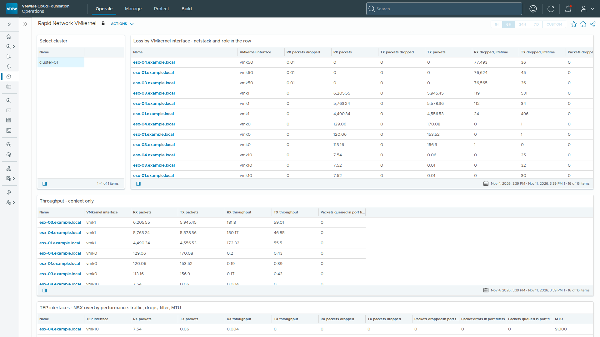

# Rapid Network VMkernel

Text panels of the **Rapid Network VMkernel** dashboard, as shipped in build 3.0.1.7 of vSphere Network Statistics. The dashboard sits in the *vSphere Network Statistics* dashboard folder.

The first screen of the dashboard; select it for the whole dashboard (`dashboard.png`).
The screenshot is from a lab; host, VM, cluster, portgroup and switch names and addresses have been replaced with neutral ones.

## How to read this

### Rapid Network VMkernel — is a netstack dropping?

One row per VMkernel interface on each host of the selected cluster. The values live on vCenter's own host object, under `pcktpshr|VMkernel:vmkN`. The netstack (`defaultTcpipStack`, `vmotion`, `vxlan`, `hyperbus`) and role sit in the row, so "is vMotion dropping?" and "is the overlay dropping?" are answered by reading the rows rather than by hunting. Sort any column; worst sits at the top. The TEP panel lists NSX tunnel endpoints alone, from their own `pcktpshr|TEP:vmkN` keys.

**These counters move.** The per-port statistics behind this screen are live, unlike the per-DVPort counters in the vCenter API, which exist and do not advance.

**Filter drops** are a third place a frame can die: the per-port filter chain (the ESXi firewall, NSX distributed-firewall filters). Neither the NIC counters nor the port counters include them.

**ECN and congestion control** are per netstack and should read the same on every host. One host on `cubic` among `newreno` peers is a finding, not a preference.

**MTU mismatch** compares each VMkernel interface against the MTU of the uplink it currently egresses through. It is the jumbo-frame incoherence that presents as intermittent loss under load and as nothing at all when idle. Where the egress uplink cannot be resolved, the panel reports no value rather than a zero.

**Not on this screen:** TCP-stack error rates, which have no vCenter surface at all, and per-netstack grouping as a true table — the netstack is carried in the object name instead. The pNIC screen's text lists the remaining blind spots.

**If the vSAN pack is also installed** it carries a kind whose name reads like this one — its "vSAN vmknic" objects are kernel ports too, but only the ones carrying vSAN traffic, and they come from the vSAN Performance Service rather than from the host command surface. It reaches TCP-stack rates and RDT latency this screen cannot; this screen reaches every kernel port on every netstack, which it cannot. Deliberately both.

### Every metric on this screen

Build 3.0.1.7 · release

Generated from the adapter's own model at build time, so it matches exactly what this version collects. **A blank cell is not a zero** — where a driver refuses a read or a rate has no previous sample, this pack emits nothing rather than a zero, because a zero would mean "measured, and fine".

**VMkernel interface** — 15 metrics, 7 properties

| Metric | Key | Unit | Source | Band | Notes |
|---|---|---|---|---|---|
| **RX packets dropped** · KPI | `rxDroppedRate` | packets/s | network.port.stats.get | yellow > 0, orange 0.1, red 1 | Per-netstack loss. |
| **TX packets dropped** · KPI | `txDroppedRate` | packets/s | network.port.stats.get | yellow > 0, orange 0.1, red 1 | — |
| **Packets dropped in port filters** | `filterDroppedRate` | packets/s | network.port.filter.stats.get | yellow > 0, orange 0.1, red 1 | A drop location invisible to nic.stats and port.stats both. |
| **Packet errors in port filters** | `filterErrorsRate` | errors/s | network.port.filter.stats.get | yellow > 0, orange 0.1, red 1 | — |
| **Packets queued in port filters** | `filterQueued` | — | network.port.filter.stats.get | context only, never coloured | Gauge. Non-zero under load is backpressure in the filter chain. |
| **MTU** | `mtu` | B | network.ip.interface.list | context only, never coloured | — |
| **MTU exceeds its switch's lowest uplink** | `mtuMismatch` | — | derived on the adapter | 0/1 state — 1 is red | The failure mode is a vmk sending frames its uplink cannot carry (vmk 9000 on a 1500 uplink) -- those drop silently under load. A 1500 vmk on a 9000 uplink is normal and must NOT fire. Compared against EVERY up, non-virtual, non-USB uplink on this interface's own switch, not against one active uplink -- the active uplink for a vmk is a runtime teaming decision that nothing agentless reports. That is the stronger check: a 9000 vmk on a switch where ANY member is 1500 is exposed the moment teaming moves it. Emits nothing where the switch or its uplink set cannot be read -- an unknown team is not evidence of a healthy MTU. |
| **RX dropped, lifetime** | `rxDroppedTotal` | packets | network.nic.stats.get | context only, never coloured | Cumulative since the port was created, not a rate. |
| **TX dropped, lifetime** | `txDroppedTotal` | packets | network.nic.stats.get | context only, never coloured | Cumulative since the port was created, not a rate. |
| **RX packets** | `rxPktRate` | packets/s | network.port.stats.get | context only, never coloured | — |
| **TX packets** | `txPktRate` | packets/s | network.port.stats.get | context only, never coloured | — |
| **RX throughput** | `rxBps` | B/s | network.port.stats.get | context only, never coloured | — |
| **TX throughput** | `txBps` | B/s | network.port.stats.get | context only, never coloured | — |
| **RX throughput** | `rxMbitps` | Mbit/s | derived on the adapter | context only, never coloured | Bits, not bytes -- a network is specified and sold in bits. `rxBps` carries the same counter in bytes/s. |
| **TX throughput** | `txMbitps` | Mbit/s | derived on the adapter | context only, never coloured | Bits, not bytes -- a network is specified and sold in bits. `txBps` carries the same counter in bytes/s. |

| Property | Key | Source | Notes |
|---|---|---|---|
| **Role** | `role` | derived on the adapter | TEP / vMotion / Management / Hyperbus / Storage, derived from the netstack. TEP == the `vxlan` netstack, which is the NSX tunnel endpoint -- a reliable discriminator. This is the column the TEP view is read on: Operations views select by resource KIND, not by property value, so the view ships the whole kind with role leading and the operator sorts on it. |
| **Netstack** | `netstack` | network.ip.interface.list | defaultTcpipStack / vmotion / vxlan / hyperbus. The grouping dimension -- carry it in the object name too, see tools/build_dashboard.py. |
| **Switch port ID** | `portId` | network.ip.interface.list | — |
| **Switch** | `switch` | network.ip.interface.list | The vSwitch or DVS this interface egresses through, from `network ip interface list` (VDSName / Portset). Replaces an "Egress uplink" column that was blank on every row: the ACTIVE uplink for a VMkernel port is a runtime teaming decision, and nothing agentless reports it -- esxcli exposes TeamUplink only on the VM-port surface, and a DVPort's runtimeInfo names linkPeer and the MAC but not the uplink. The switch is the honest unit: it is what the MTU check compares against. |
| **ECN** | `ecnStatus` | network.ip.netstack.get | Per netstack. |
| **Port filter statistics** | `filterStatsAvailable` | derived on the adapter | Whether the IOChain filter on this port reports counters. The filter differs by port type: VMkernel ports carry <code>ESXi-Firewall</code>, the host firewall; VM ports carry <code>vmware-vds-vsip</code>, the NSX distributed firewall dataplane. Neither is NIOC -- network shares, limits and reservations are a DVS scheduler rather than an IOChain filter, so they never appear here. |
| **TCP congestion control** | `congestionControl` | network.ip.netstack.get | Per netstack. A stack set to cubic on one host and newreno on another is a finding. |

## Complete the install

### Complete the install

Installing the pak adds these dashboards, but **it cannot create its own vCenter connection**. Until the steps below are done, every panel above stays empty.

**1. Add the vCenter account8.18:** Administration → Integrations → Accounts → **ADD** → **vSphere Network Statistics9.1.1:Operate** tab → Administration → Integrations → Accounts → **ADD** → **vSphere Network Statistics**

Fill in **Name**; **vCenter Server (FQDN)**, the name on vCenter's certificate; **Port** 443; **Credential**, a *read-only* vCenter user and password; and the proxy that reaches vCenter, under **Collector / Group** on 8.18 or **Cloud Proxy / Group** on 9.1.1. Leave **Advanced Settings** as they are. Then **VALIDATE CONNECTION**, accept vCenter's certificate when asked, and **ADD**.

**2. Make sure it is collecting**

Administration → Integrations → Accounts, expand **vSphere Network Statistics** with its arrow. The account's **Status** should read `OK` on 8.18 or `Collecting` on 9.1.1. If it does not, open the account's **⋮** menu and choose **Start Collecting**. Accepting the certificate can leave the account stopped, and so can a pak upgrade, so check again after either.

**3. Coming from 2.x**

If the 2.x pack is still installed, delete its account and uninstall it (Integrations → Repository). 2.x and 3.x write the same keys, so only one may run against a vCenter. History carries over: the keys are unchanged.

**4. Then wait**

Values arrive within one collection cycle (about 5 minutes). Rate and percentage columns fill from the second cycle. Right after an install or upgrade every widget can show *The widget is not configured* with an hourglass for up to 15 minutes while Operations binds it to its view; nothing needs doing.
